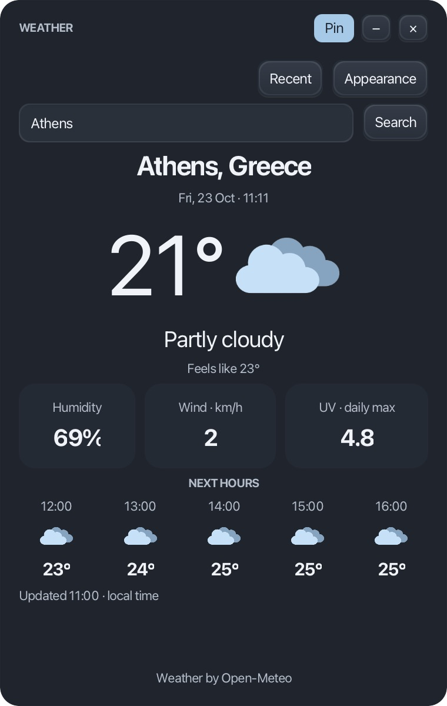
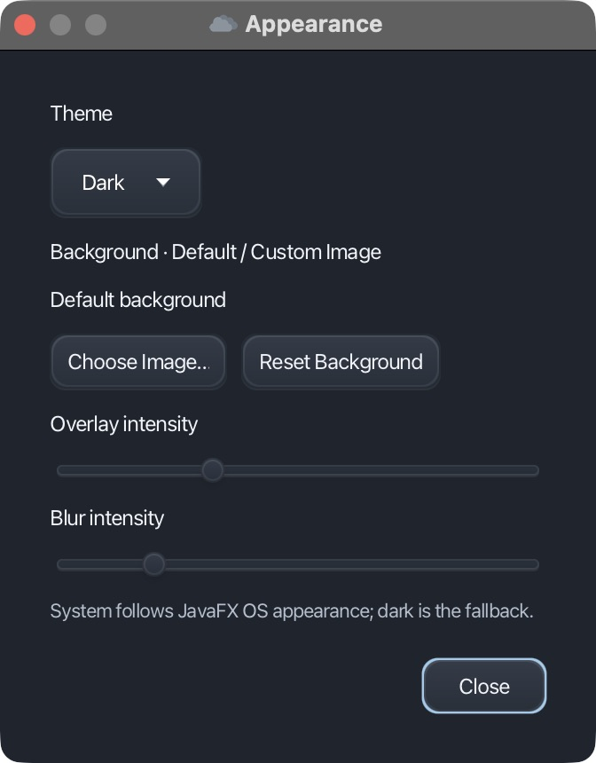

<div align="center">

# Weather Widget

**Your weather. A quieter desktop.**

A compact JavaFX weather companion with a graphite dark theme, live forecasts, and a floating window that stays where you need it.

Java 21+ · JavaFX · Open-Meteo · SQLite · Maven

[Get started](#run-locally) · [Features](#features) · [Architecture](#architecture) · [Packaging](docs/PACKAGING.md)

</div>

## A look at the app

<div align="center">

| Athens · Dark mode | Appearance · Dark mode |
| :---: | :---: |
|  |  |

</div>

Actual application screenshots. Weather values reflect the time of capture.

## Features

- **Weather at a glance** — current temperature, conditions, feels-like temperature, humidity, wind, and daily maximum UV.
- **The next five hours** — a compact forecast using the selected city's local timezone.
- **A floating desktop widget** — rounded corners, a draggable header, a fixed 380×600 window, and optional always-on-top pinning.
- **Make it yours** — Dark, Light, and System themes, plus local image backgrounds with adjustable overlay and blur.
- **Pick up where you left off** — saved appearance, last location, window position, and pin preference.
- **Recent searches** — revisit a location and see its search count and average recorded temperature, stored locally in SQLite.
- **Responsive interactions** — background requests, clear loading/error messages, keyboard navigation, and search via Enter or the Search button.

No API key is required. Temperatures use °C and wind uses km/h. UV is the daily maximum, rather than a live reading.

## Run locally

Install **JDK 21 or newer** and **Maven 3.9+**.

```sh
git clone https://github.com/xanthosgeorge/Weather-App.git
cd Weather-App
mvn clean test
mvn javafx:run
```

Maven downloads the JavaFX dependencies for your operating system. For IDE use, import `pom.xml` as a Maven project.

### Desktop controls

| Control | Action |
| --- | --- |
| **WEATHER** header | Drag to move the widget |
| **Pin** | Toggle always-on-top behavior |
| **−** | Minimize; restore from the Dock on macOS |
| **×** | Close the application |
| **Recent** | Reopen a previously searched city |
| **Appearance** | Choose a theme or background and adjust overlay/blur |

The widget is a standalone Java desktop app. It does not appear in the macOS widget gallery or automatically launch at login. Fullscreen apps and Spaces are managed by macOS.

## Architecture

```text
src/main/java/widget/
├── app/          Application entry point and lifecycle
├── api/          Open-Meteo HTTP requests, geocoding, and parsing
├── model/        Immutable weather/forecast records and WMO descriptions
├── repository/   SQLite history and recent-location statistics
├── service/      Weather orchestration and saved preferences
└── ui/           JavaFX views, appearance, and floating-window behavior
src/main/resources/
├── assets/       Bundled weather icons
└── widget.css    Dark/light styling
src/test/java/widget/
└── WeatherTest.java
```

The UI uses JavaFX layouts and CSS. API, database, and image loading run on a background executor; view updates stay on the JavaFX thread. Weather can still display when saving search history fails. Bundled icons load from the classpath, including after packaging.

### Technology

| Component | Technology |
| --- | --- |
| Language | Java, targeting Java 21 LTS |
| Desktop UI | JavaFX 23 and CSS |
| Weather and location search | Open-Meteo forecast and geocoding APIs |
| Search history | SQLite via JDBC |
| Preferences | Java Preferences |
| Build and tests | Maven and JUnit 5 |

## Local data

Search history lives at `~/.weather-widget/history.sqlite`. The original `WeatherSearch` schema is preserved. On first use, an `identifier.sqlite` file in the launch directory is copied there if no history database exists. The source database is left untouched. Launch from the repository root on first use to import the included MSc records.

Appearance, last city, window position, and pin state use Java Preferences under `dev/weather/widget`. Background images remain on your computer and are never uploaded. Missing or invalid images fall back to the default background with an error message.

Search counts and average temperatures describe saved searches, not long-term climate statistics. System theme follows the platform appearance signal where available, with a dark fallback.

## Build and verification

```sh
mvn clean package
```

Tests cover location timezone/forecast parsing, optional values, weather-code mapping, and compatibility with the legacy SQLite schema. For a native app image or installer, see [desktop packaging](docs/PACKAGING.md).

## Project background

Originally developed as an MSc Java/Swing project, Weather Widget was modernized into a JavaFX desktop application while retaining its Open-Meteo integration and useful SQLite history.

## Data and credits

Weather is provided by [Open-Meteo](https://open-meteo.com/), using its [forecast](https://open-meteo.com/en/docs) and [geocoding](https://open-meteo.com/en/docs/geocoding-api) APIs. Geocoding data is attributed to GeoNames by Open-Meteo. The weather icons are retained from the original project; their provenance should be confirmed before redistribution.

An internet connection is required. Search again to refresh the weather. Offline caching, automatic weather refresh, city-result selection, and signed installers are not currently included.
